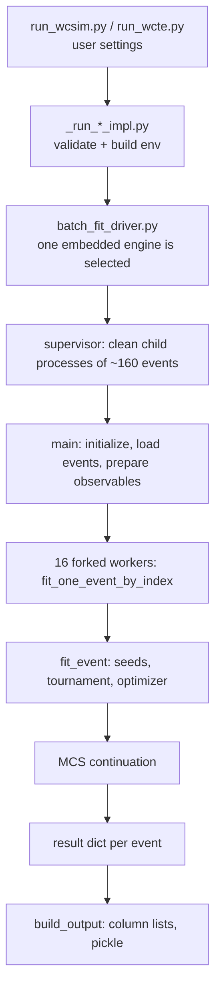

# LicketyFit: how the fit works, from input to output

This document explains the single-track reconstruction implemented in
[scripts/batch_fit_driver.py](scripts/batch_fit_driver.py) and the
[LicketyFit/](LicketyFit/) package, for both **WCSim Monte Carlo** and **real WCTE data**.
Line numbers refer to the checked-in sources and will drift as the code changes.

Contents

1. [Big picture](#1-big-picture)
2. [Configuration and launch](#2-configuration-and-launch)
3. [Particle hypothesis ("PID")](#3-particle-hypothesis-pid)
4. [Input stage: WCSim vs WCTE](#4-input-stage-wcsim-vs-wcte)
5. [Event preparation](#5-event-preparation)
6. [Setup: geometry, models, seed and proxy libraries](#6-setup-geometry-models-seed-and-proxy-libraries)
7. [Forward model](#7-forward-model)
8. [Likelihood](#8-likelihood)
9. [Optimizer](#9-optimizer)
10. [Per-event search: `general` + `full_length` (cosmic engine)](#10-per-event-search-general--full_length-cosmic-engine)
11. [Multiple-scattering (MCS) stages](#11-multiple-scattering-mcs-stages)
12. [Other modes: `beam` and `absorption` (standard engines)](#12-other-modes-beam-and-absorption-standard-engines)
13. [Output assembly and orchestration](#13-output-assembly-and-orchestration)
14. [WCSim vs WCTE: summary of differences](#14-wcsim-vs-wcte-summary-of-differences)
15. [Pitfalls and things the output does not tell you](#15-pitfalls-and-things-the-output-does-not-tell-you)

---

## 1. Big picture

LicketyFit reconstructs **one charged particle track per event** in a water Cherenkov detector
(WCTE or IWCD geometry). For each event it:

1. Reduces the digitized hits to one **charge** `q_i` and one **time** `t_i` per PMT.
2. Predicts the same two numbers per PMT from a **parametric track hypothesis**
   (start point, direction, range, event time), using a physical Cherenkov light model.
3. Minimizes a **negative log-likelihood (NLL)** over the track parameters, starting from a bank
   of seeds and picking between discrete topologies.
4. Optionally refines the result with a **multiple-scattering (MCS)** model that lets the path
   curve.

The driver embeds **four engines** in one 45k-line file. Only the selected one runs
([scripts/batch_fit_driver.py](scripts/batch_fit_driver.py#L3526)):

| Engine | Chosen when | Starts at |
|---|---|---|
| WCSim standard | WCSim and `beam` or `absorption` | [L3579](scripts/batch_fit_driver.py#L3579) |
| **WCSim cosmic** | WCSim and `general` + `full_length` | [L9097](scripts/batch_fit_driver.py#L9097) |
| WCTE standard | WCTE and `beam` or `absorption` | about [L23950](scripts/batch_fit_driver.py#L23950) |
| **WCTE cosmic** | WCTE and `general` + `full_length` | about [L30340](scripts/batch_fit_driver.py#L30340) |

"Cosmic" is the internal name for `general` + `full_length`
([LicketyFit/run_configuration.py](LicketyFit/run_configuration.py#L113)): any direction, any
start inside or at the detector wall, range that can be longer or shorter than the visible chord.
The two cosmic engines share the same algorithm and differ only in the data adapter (section 14).

---

## 2. Configuration and launch

* User edits [scripts/run_wcsim.py](scripts/run_wcsim.py) or
  [scripts/run_wcte.py](scripts/run_wcte.py). These only hold constants and then call
  `install_launcher` (`launcher_loader`).
* [scripts/_run_wcsim_impl.py](scripts/_run_wcsim_impl.py) and
  [scripts/_run_wcte_impl.py](scripts/_run_wcte_impl.py) validate settings, resolve absolute-light
  manifests, and translate everything to environment variables in `build_environment`
  ([WCSim](scripts/_run_wcsim_impl.py#L750), [WCTE](scripts/_run_wcte_impl.py#L814)).
* [LicketyFit/run_configuration.py](LicketyFit/run_configuration.py#L207)
  (`resolve_reconstruction_configuration`) is shared by both launchers. It enforces which
  combinations are legal and which MCS selector is active:
  * Two independent axes: `SEEDING_MODE` (`general` | `beam`) and `INTERACTION_MODE`
    (`full_length` | `absorption`).
  * Only `general` + `full_length` uses `COSMIC_MCS_CONTINUATION`; every other pair uses
    `PRIMARY_MCS_MODEL` and `COHERENT_MCS_IMPLEMENTATION` instead.
  * `auto` coherent implementation resolves to `standard_fe_process` for absorption,
    `physics_reference` for beam + full_length, and `fast12_profile` for general
    ([L283-L291](LicketyFit/run_configuration.py#L283)).
  * `charge_only` with navigation other than `off` is rejected, because navigation uses timing.
  * `timing_only` with an MCS continuation is rejected, because MCS needs charge.
* [scripts/single_event_fit.py](scripts/single_event_fit.py) offers the same configuration to a
  notebook (`WCSimConfig`, `WCTEConfig`, `SingleEventFitter`) and calls the same
  `fit_one_event_by_index` for one event.
* [LicketyFit/Emitter.py](LicketyFit/Emitter.py#L73) holds the physics defaults
  (`DEFAULT_ENABLE_PRIMARY_MCS`, `DEFAULT_ENABLE_DELTA_E`, `DEFAULT_ENABLE_RAYLEIGH`,
  `DEFAULT_ENABLE_BLACKSHEET_REFLECTION`, `DEFAULT_COSMIC_MCS_CONTINUATION`); the launchers
  override them through the environment.

### Supervisor (clean child processes)

For `general` + `full_length` the top-level process does not fit anything itself:
`run_wcsim_cosmic_supervisor` ([L2429](scripts/batch_fit_driver.py#L2429)) and
`run_wcte_cosmic_supervisor` ([L2590](scripts/batch_fit_driver.py#L2590)) re-launch the driver as
child processes, each handling a chunk of `NPROC * tasks_per_worker` events (16 x 10 = 160 by
default). Each child writes `part_NNNN_<start>_<count>.dict` plus `.log` and `.progress` files in
`<output>.parts.<pid>/`, and the parent merges them with `_merge_child_outputs`
([L1570](scripts/batch_fit_driver.py#L1570)). The purpose is bounded native/OpenMP state and
stall detection (`CHILD_STALL_TIMEOUT_SECONDS`).

---

## 3. Particle hypothesis ("PID")

There is **no particle classifier inside the fit**. `FIT_PARTICLE` is an assumption
(`muon`, `pion`, `kaon`, `proton`) that fixes the physics tables. It is applied by
`set_active_particle` and `ParticleRangeLookup` in `initialize()`
([WCSim](scripts/batch_fit_driver.py#L21643), [WCTE](scripts/batch_fit_driver.py#L43667)).

What the hypothesis controls, from
[LicketyFit/particle_cherenkov_model.py](LicketyFit/particle_cherenkov_model.py#L47):

| Quantity | Source |
|---|---|
| Mass (muon 105.658, pion 139.570, kaon 493.677, proton 938.272 MeV) | `PARTICLE_MASS_MEV` |
| Cherenkov threshold kinetic energy $K_{thr}=m(\gamma_{thr}-1)$, $\beta_{thr}=1/n$, $n=1.344$ | `cherenkov_threshold_kinetic_mev` ([L128](LicketyFit/particle_cherenkov_model.py#L128)) |
| Range to threshold vs. kinetic energy (CSDA tables) | `E_vs_dist_cm_<particle>.npy`, `overall_distances_cm_<particle>.npy` |
| Stopping power used by the delta-electron and primary light model | `_get_particle_stopping_power_table` |
| Light below threshold (electromagnetic tail, mm: muon 120, pion 158.5, kaon 560.7, proton 1048.2) | `PARTICLE_SUBTHRESHOLD_RANGE_MM` |
| Range straggling and MCS | [LicketyFit/stopping_straggling.py](LicketyFit/stopping_straggling.py) |

Consequences:

* For **WCSim** you must choose `FIT_PARTICLE` to match the simulated particle.
* For **real WCTE data** the PID is a *beam selection applied by the loader before the fit*
  (section 4.2). `PARTICLE_SELECTION_LABEL` (which sample is loaded: muon, pion, electron,
  proton) is independent of `FIT_PARTICLE` (which physics is fitted). The driver records
  `selection_matches_fit_hypothesis` in the metadata
  (`metadata["selection"]` in `build_output`). An electron-selected sample has no
  electron forward model; it must be fitted under one of the four supported hypotheses.
* Hadronic interactions and pi/K decay are explicitly not modelled
  ([LicketyFit/particle_cherenkov_model.py](LicketyFit/particle_cherenkov_model.py#L56)).

---

## 4. Input stage: WCSim vs WCTE

### 4.1 WCSim

* Input is a digitized NPZ with `digi_hit_pmt`, `digi_hit_charge`, `digi_hit_time` per event
  (`FIT_FIELDS`, read by `read_sim_data`). Charges are already in PE.
* Optional truth: `USE_TRUTH_ROOT` loads a per-step ROOT tree (`AllSecondaries`) through
  [LicketyFit/wcsim_truth.py](LicketyFit/wcsim_truth.py). It is diagnostic only and never enters
  the likelihood. Events are matched by `evt = source_event_index + TRUTH_EVENT_ID_OFFSET`;
  `extract_active_water_entries_from_chunks` ([L929](LicketyFit/wcsim_truth.py#L929)) builds the
  record, and a missing `evt` gives status `missing_root_event` ([L1209](LicketyFit/wcsim_truth.py#L1209)).
* `USE_THROUGHGOING=True` fits only events whose primary exits the active water; the rest get a
  skipped placeholder row (`THROUGHGOING_SKIP_REASONS`,
  [L23640](scripts/batch_fit_driver.py#L23640); `_skipped_event_result`,
  [L3359](scripts/batch_fit_driver.py#L3359)). If truth lookup fails for an event, it is skipped
  with reason `not_throughgoing:<status>`.
* PMT ids are mapped from WCSim tube numbers to `100*slot + position`
  (`PMT_ID_MODE`, `PMT_ID_OFFSET`, [tables/wcsim_wcte_mapping.txt](tables/wcsim_wcte_mapping.txt)).

### 4.2 WCTE (real data)

Events come from the production ROOT file `WCTE_merged_production_R<run>.root`, via the
`analysis_tools` submodule `DataLoader` and `BeamSelection`, wrapped by
[scripts/wcte_data_loader_adapter.py](scripts/wcte_data_loader_adapter.py)
(`load_selected_events`, [L1735](scripts/wcte_data_loader_adapter.py#L1735)). Called from
`load_input_events` ([L43198](scripts/batch_fit_driver.py#L43198) in the cosmic engine).

Steps in `load_selected_events`:

1. **Scalar thresholds** (`_selection_thresholds`,
   [L809](scripts/wcte_data_loader_adapter.py#L809)) come from the run's VME scalar results:
   ACT e-veto and tagger cuts (PE), proton TOF cut (ns), muon-tag cut, and, for light particles,
   the electron/muon and muon/pion TOF boundaries. If an explicit boundary is not stored, it is
   built as the **equal-PDF intersection** of two Gaussians from the stored TOF means and widths
   (`_equal_pdf_boundary`, [L744](scripts/wcte_data_loader_adapter.py#L744)). Any boundary can be
   overridden by the user.
2. **PID cuts** (`_selection_specs`, [L1155](scripts/wcte_data_loader_adapter.py#L1155)):

   | Label | `act_tof` (default) | notes |
   |---|---|---|
   | muon | `vme_act_eveto < cut`, `vme_act_tagger > cut`, `vme_tof_corr between [e/mu, mu/pi]` | optional `vme_mu_tag_total > cut` |
   | pion | `vme_act_eveto < cut`, `vme_act_tagger < cut`, TOF between mu/pi and proton cut | |
   | electron | `vme_act_eveto > cut`, TOF below e/mu | |
   | proton | `vme_tof_corr between [tof, tof + window]` | needs a positive proton TOF cut |

   `LIGHT_PARTICLE_PID_MODE` can be `act`, `tof`, or `act_tof`. In `act_tof`, an unusable TOF
   boundary is dropped and the fallback is recorded
   (`light_particle_tof_fallback_used`); in `tof` it is an error. `SELECTION_MODE="custom"`
   replaces the nominal cuts with `EXTRA_SELECTION_CUTS` (required for kaons).
3. **Scan then load**: a fast scalar pass over `WCTEReadoutWindows` (at most `N_ROOT_ENTRIES`)
   applies event-level DQ and `BeamSelection`; only selected entries are then re-read with full
   hit payloads and hit-level DQ (`_scan_selected_root_indices`, `_load_selected_records_by_index`).
4. **Hit table** (`_record_to_event`, [L1661](scripts/wcte_data_loader_adapter.py#L1661)): five
   columns `[global PMT id = 100*slot+position, charge (calibrated ADC), calibrated time (ns),
   ROOT entry index, event number]`. Optional legacy T5-relative or calibrated-peak hit-time
   cuts exist but are off by default.
5. Alternatively `EVENT_SOURCE="file"` loads an already-selected NPY/NPZ/PKL file
   (`load_user_event_file`, [L43184](scripts/batch_fit_driver.py#L43184)) with strict validation.

The **active PMT list** is authoritative from a user file or the run's DQ/merged ROOT
(`resolve_good_wcte_pmts`; `load_good_wcte_pmts`
[L32412](scripts/batch_fit_driver.py#L32412)). WCSim's inactive-slot list is not used in WCTE mode.

---

## 5. Event preparation

`prepare_event_observables` turns the raw hit list into two arrays aligned with the fitter's PMT
ordering, plus a prompt window.

### WCSim ([L21331](scripts/batch_fit_driver.py#L21331))

1. `prompt_select` ([L11013](scripts/batch_fit_driver.py#L11013)): histogram hit times in 1 ns
   bins from 0 to `PRIMARY_PROMPT_PEAK_SEARCH_MAX_NS` (1000 ns); take the peak bin; keep hits with
   `0 < t < peak + 5 ns`. A fixed window can be set instead.
2. `event_from_wcsim` fills a status-aware `Event` (inactive PMTs excluded).
3. `build_observables` ([L10992](scripts/batch_fit_driver.py#L10992)): per PMT,
   $q_i=\sum q$ and $\bar t_i=\sum q\,t/\sum q$ (charge-weighted mean); PMTs with no charge get
   $q=0$, $t=\mathrm{NaN}$.
4. Optional ring mask.

### WCTE ([L43293](scripts/batch_fit_driver.py#L43293))

1. Drop non-finite hits. `prompt_select` ([L32731](scripts/batch_fit_driver.py#L32731)):
   histogram (1 ns bins, search 0 to 4000 ns), peak bin left edge $p$, window
   $(\max(0,p-20),\ \min(4000,p+5))$ ns. Modes `none` and `fixed` exist.
2. Keep only PMTs in `ACTIVE_WCTE_PMT_IDS`.
3. **Event time reference** `estimate_event_time_offset`
   ([L32668](scripts/batch_fit_driver.py#L32668)): default `beam_corrected_peak`. Each hit time is
   corrected for light travel from a reference point `(0, 0, -1350)` mm at speed 223.06 mm/ns, a
   0.5 ns histogram is built, and the centre of the modal bin is the offset. Other modes:
   `beam_corrected_local_median`, `beam_all_median`, `beam_earliest` (median of the 10 earliest
   corrected hits), `none`. Times and the prompt window are shifted by this offset
   (`global_time_offset_ns` is saved).
4. `event_from_wcte_hits` and `build_observables` ([L32710](scripts/batch_fit_driver.py#L32710)):
   same charge-weighted mean time, but charge is converted from ADC to PE:
   $q_i=\sum q_{ADC}/\texttt{CHARGE\_ADC\_PER\_PE}$ (default 143).
5. Events with no finite active prompt charge are skipped
   (`SKIPPED_EVENT_RECORDS`, reason "no finite active prompt PE after real-data preparation").

Both engines also set `PMT_MODEL.first_arrival_prompt_min_ns / max_ns` per event
([L22198](scripts/batch_fit_driver.py#L22198)); the timing likelihood conditions on this window.

---

## 6. Setup: geometry, models, seed and proxy libraries

`initialize()` ([WCSim L21643](scripts/batch_fit_driver.py#L21643),
[WCTE L43667](scripts/batch_fit_driver.py#L43667)) runs once per process and builds the
immutable state that forked workers share copy-on-write.

1. **Geometry**: `Device.open_file(GEOMETRY_FILE)` (`Geometry/examples/wcte_bldg157.geo`),
   `DetectorGeometrySummary`, and `ConvexDetectorVolume.from_wcd`
   ([LicketyFit/fast_track_fit.py](LicketyFit/fast_track_fit.py#L77)): a convex prism of 106
   inward planes, `contains`, `ray_exit_distance`, `segment_contained`. In cosmic mode mPMT dome
   caps are excluded from "active water" (`include_mpmt_dome_exclusions`).
2. **PMT ordering**: WCSim builds it from the `Event` status masks. WCTE builds it from the
   sorted authoritative PMT id list, using surveyed (`est`) placements with design fallback
   (`_active_wcte_pmt_placements`, [L32497](scripts/batch_fit_driver.py#L32497)).
3. **Relative mPMT efficiency** (WCTE only, `RELATIVE_EFFICIENCY_MODE` = `slot` | `type` | `none`):
   `configure_relative_efficiency` ([L32555](scripts/batch_fit_driver.py#L32555)) installs a
   per-slot or per-type data/MC efficiency vs. $\cos\theta$ table in the Emitter
   (`set_rel_eff_mode`, [LicketyFit/Emitter.py](LicketyFit/Emitter.py#L830)). WCSim passes
   `mpmt_types=None`, an exact identity branch.
4. **`PMT` model**: [LicketyFit/PMT.py](LicketyFit/PMT.py#L2837) with single-PE amplitude and time
   parameters. WCSim uses `wcsim_r14374_ski` (reproduces the R14374 charge table and SK-I
   threshold, [LicketyFit/wcsim_charge_response.py](LicketyFit/wcsim_charge_response.py)); WCTE
   uses `gaussian_censored` ([L3548](scripts/batch_fit_driver.py#L3548)).
5. **Emitter template** (`Emitter(...)`, [LicketyFit/Emitter.py](LicketyFit/Emitter.py#L5728)),
   `configure_emitter_for_detector`: reflection policy and photon-boundary model by detector.
   The driver checks the Emitter's MCS master switch against its own resolution and refuses to
   run on a mismatch.
6. **Seed library** `build_seed_library` ([L11388](scripts/batch_fit_driver.py#L11388)):
   * *WCTE geometry, `general`*: a **beam cluster** (`wcte_beam_cluster`) around the beam entry
     `(0,0,-1350)` mm along $+z$; an **orientation guard** (`wcte_orientation_guard`, Fibonacci
     sphere directions at the walls); and a **detector-global** bank
     (`wcte_detector_global`, `build_budgeted_global_seed_grid`,
     [LicketyFit/fast_track_fit.py](LicketyFit/fast_track_fit.py#L2856)). The expected-energy hint
     is off by default (`WCTE_USE_EXPECTED_ENERGY_HINT`, [L9392](scripts/batch_fit_driver.py#L9392));
     lengths then come from `broad_length_grid`
     (`wcte_length_grid`, [L11181](scripts/batch_fit_driver.py#L11181)).
   * *Cosmic extension*: every seed is tagged `internal_start`; `_build_auto_boundary_entry_seeds`
     ([L11273](scripts/batch_fit_driver.py#L11273)) adds `boundary_entry` seeds, chords along
     Fibonacci directions with ranges set as fractions of the chord (below 1 stops, 1 or more
     leaves).
   * *IWCD*: only a budgeted detector-global grid.
7. **Quantized proxy library** (`QuantizedSeedProxyLibrary`,
   [LicketyFit/fast_track_fit.py](LicketyFit/fast_track_fit.py#L2024)): for every seed the
   normalized per-PMT (or per-mPMT) charge shape is predicted once with a cheap emitter (no
   delta light, no molecular scattering), log-quantized to 8 bits, cached on disk, and hashed
   against geometry and configuration. Scoring an event against all seeds is
   $\mathrm{score}_s=-\sum_g q_g\,\ln \hat p_{s,g}$ over hit groups
   ([L1957](LicketyFit/fast_track_fit.py#L1957)); it is fast because the unhit Poisson term is
   common to all seeds.
8. Kernel warm-up (Numba/native) runs in a serial bootstrap, never in worker initializers.

---

## 7. Forward model

`TrackObjective.__call__` ([LicketyFit/fast_track_fit.py](LicketyFit/fast_track_fit.py#L781)) turns
a parameter dict into an NLL.

### 7.1 Parameters

| Name | Meaning |
|---|---|
| `x0,y0,z0` | line reference point (start for `internal_start`, a point on the line for `boundary_entry`) |
| `dir_u,dir_v` | direction in a seed-centred tangent chart (`TangentDirectionChart`, [LicketyFit/track_parameterization.py](LicketyFit/track_parameterization.py)); no $c_z=0$ singularity |
| `length` | in cosmic mode: **full CSDA range to Cherenkov threshold** (not the visible chord) |
| `t0` | event time |
| `visible_length`, `full_range` | `absorption` mode only, 8 parameters |

Direction chart, `FIXED_PARAMETERS` and fixed-direction handling are in
[LicketyFit/fixed_parameters.py](LicketyFit/fixed_parameters.py).

### 7.2 Evaluation steps

1. Reject if the vertex is outside the detector, `t0` is outside `T0_LIMITS`, or the range is
   beyond the table.
2. `ke0 = RANGE_LOOKUP.range_mm_to_energy(full_range)`; reject if $K_0\le K_{thr}$.
3. Cosmic clipping: the visible length is $\min(\text{full\_range}, d_{exit}-\text{inset})$ where
   `ray_exit_distance` gives $d_{exit}$. The Emitter is put in `abrupt` track-end mode with
   `fixed_initial_KE=ke0` (the light ends at the wall even if the particle continues).
4. `Emitter.refresh_kinematics_from_length` / `from_energy` sets $\beta(s)$, $K(s)$ tables
   ([LicketyFit/Emitter.py](LicketyFit/Emitter.py#L6780)).
5. `get_emission_points` ([L7097](LicketyFit/Emitter.py#L7097)) computes the emission coordinate
   for each PMT, $s=u-\cot\theta_C\sqrt{A-u^2}$ with $u=\hat d\cdot\Delta r$, $A=|\Delta r|^2$.
6. `get_expected_pes_ts` ([L8243](LicketyFit/Emitter.py#L8243)) returns expected PE and a
   **first-arrival timing prediction** (`TimingPrediction`,
   [L1068](LicketyFit/Emitter.py#L1068)). The heavy part is `find_scale_for_pmts` in
   [LicketyFit/particle_cherenkov_model.py](LicketyFit/particle_cherenkov_model.py) (cone
   collapse: integrate yield along the track using $\theta_C(E(s))$) and a fused Numba kernel
   (`_fused_primary_kernel`).
7. The prediction is computed **once at $t_0=0$** and cached by geometry key; `t0` only shifts
   times. This makes `t0` profiling nearly free.

### 7.3 Physics included

Switches live in [LicketyFit/Emitter.py](LicketyFit/Emitter.py#L73):

* **Primary Cherenkov light** with PMT angular response (`power_law`), wavelength correction
  (`wl_corr`), relative mPMT efficiency, finite-aperture endpoint model.
* **Delta electrons** (refined analytic tables, `get_refined_analytic_delta_cache`).
* **Molecular (Rayleigh) photon scattering**: sparse receiver table plus optional native OpenMP
  receiver ([LicketyFit/photon_scattering_native.py](LicketyFit/photon_scattering_native.py),
  [photon_scattering_physics.py](LicketyFit/photon_scattering_physics.py),
  [photon_scattering_transport.py](LicketyFit/photon_scattering_transport.py)).
* **Blacksheet reflection**: enters first-arrival timing; enters charge only if the absolute-light
  manifest says so.
* **Optical obstacles** such as the WCTE CDS tube
  ([LicketyFit/optical_obstacles.py](LicketyFit/optical_obstacles.py)), off by default.
* **MCS**: local smearing in the Emitter, or the coherent path model of section 11.

---

## 8. Likelihood

`objective_mode` is `charge_only`, `timing_only`, or `charge_time`
([LicketyFit/fast_track_fit.py](LicketyFit/fast_track_fit.py#L571)).

### 8.1 Charge

* Default `poisson_pe` ([LicketyFit/PMT.py](LicketyFit/PMT.py#L213)):
  $$\mathrm{NLL}_Q=\sum_i\big[\lambda_i-q_i\ln\lambda_i\big]$$
  with a noise floor $\ln 10^{-4}$ where $\lambda_i=0$ and $q_i>0$. The $\ln q_i!$ constant is
  omitted.
* `compound_spe_profile`: threshold-censored compound single-PE response with an event-level gain
  profiled out ([L568](LicketyFit/PMT.py#L568)); `compound_spe_calibrated` for absolute light.
* **Normalization**: with `USE_ABSOLUTE_LIGHT_YIELD=False` (default) each prediction is rescaled
  to the observed event total ("event_mean"); only the charge *shape* is used. With
  `True`, a calibrated global scale from an absolute-light manifest is used
  ([LicketyFit/absolute_light_calibration.py](LicketyFit/absolute_light_calibration.py),
  [tables/](tables/)). WCSim manifests are rejected for WCTE and vice versa.

### 8.2 Timing: conditional first-photoelectron mixture

`_first_arrival_nodes_nll_numba` ([LicketyFit/PMT.py](LicketyFit/PMT.py#L907)):

For each PMT with $q>0$ and a finite time, the model sources are ordered in time with amplitudes
$\mu_j$. With $n_{eff}=q/0.985$ and $S_j$ the remaining fraction after source $j$, the weight that
source $j$ produced the first PE is $w_j=S_j^{n_{eff}}-S_{j+1}^{n_{eff}}$. It is convolved with
the WCSim WCTE first-digit transit-time Gaussian of width $\sigma(q)$ and conditioned on the prompt
window $[lo,hi]$:

$$\mathrm{NLL}_{T,i}=-\ln\frac{\sum_j w_j\,\phi\big((t_i-\tau_j)/\sigma\big)/\sigma}
{\sum_j w_j\,[\Phi(\tfrac{hi-\tau_j}{\sigma})-\Phi(\tfrac{lo-\tau_j}{\sigma})]}$$

The code also has deferred-reflection variants and batched many-$t_0$ evaluation
(`get_neg_log_likelihood_t_many_t0`). The older mean-time Gaussian model
(`_poisson_time_nll`) is the fallback for non-first-arrival predictions.

### 8.3 Combined

`charge_time` = charge NLL + timing NLL (`get_neg_log_likelihood_npe_t`); with cached charge
reuse the two parts are summed explicitly. An optional $t_0$ prior is available
(`USE_T0_PRIOR`, off by default).

### 8.4 `t0` profiling

`profile_t0` ([LicketyFit/fast_track_fit.py](LicketyFit/fast_track_fit.py#L1775)): scan the
`T0_LIMITS` range on a coarse grid (`T0_PROFILE_COARSE_STEP_NS` = 0.25 ns), then refine around
the best point with step divided by `refine_factor` (5) for `refine_levels` rounds, keeping the
lowest NLL, and reporting a three-point curvature error. The production latency profile
reduces this to few global points and one refinement level
(`T0_PROFILE_MAX_GLOBAL_POINTS=3`, `T0_PROFILE_REFINE_LEVELS=1`).

---

## 9. Optimizer

`track_aligned_block_optimize` ([LicketyFit/fast_track_fit.py](LicketyFit/fast_track_fit.py#L1150))
is a custom trust-region, block-coordinate quadratic optimizer. It is **not** Minuit.

* **Blocks** (`_active_blocks`, [L1013](LicketyFit/fast_track_fit.py#L1013)) depend on topology:
  * `internal_start`: longitudinal + range; transverse-1 + `dir_u`; transverse-2 + `dir_v`; `t0`.
  * `boundary_entry`: no longitudinal move (the point slides along the line); transverse,
    direction and range.
  The vertex basis is aligned to the track (`_free_vertex_basis`), so no global axis is special.
* **One-dimensional blocks**: evaluate $f(x\pm h)$, take the parabola vertex if curvature is
  positive, clipped to $\pm 2h$.
* **Two-dimensional blocks**: sample 6 points (8 in the first `full_cross_sweeps`), build the
  gradient and a $2\times2$ Hessian, floor its eigenvalues at $\max(10^{-3},\,0.05\,|\lambda|_{max})$,
  take the Newton step, clip to $\pm 2h$.
* Every candidate is evaluated with the real objective; the best finite point (including the
  current one) is kept. If any stencil value is non-finite the quadratic step is skipped and the
  step shrinks (`quadratic_skips`).
* **Step control**: step grows by 1.2 if the move exceeded $0.7h$, otherwise shrinks by 0.7 on a
  success or 0.5 on failure, never below `OptimizerMinSteps`.
* **Stopping**: after the second sweep, stop if the sweep gain is below `min_improvement`
  ($10^{-3}$ NLL).
* **Errors**: diagonal curvature estimates in aligned coordinates, mapped to Cartesian
  coordinates (`direction_jacobian`). They are optimizer diagnostics, not a full-Hessian covariance.
* Other helpers: `cobyqa_exact_continuation` ([L1516](LicketyFit/fast_track_fit.py#L1516)) and
  `continue_adaptive_exact` ([LicketyFit/adaptive_exact.py](LicketyFit/adaptive_exact.py)) provide
  an adaptive polish when the last sweep still improved a lot (`ADAPTIVE_EXACT_POLISH`).

---

## 10. Per-event search: `general` + `full_length` (cosmic engine)

Entry point: `fit_one_event_by_index` ([WCSim L22198](scripts/batch_fit_driver.py#L22198),
[WCTE L44233](scripts/batch_fit_driver.py#L44233)), which wraps `fit_event`
([WCSim L14508](scripts/batch_fit_driver.py#L14508),
[WCTE L36266](scripts/batch_fit_driver.py#L36266)) in
`_fit_event_with_failure_record` ([L3239](scripts/batch_fit_driver.py#L3239)). The wrapper retries
once as a straight-line fit if the MCS stage raises `_CosmicMCSContinuationFailure`
(status `failed_straight_fallback`).

### 10.1 Stage A: proxy ranking

`PROXY_LIBRARY.score(obs_pes)` ranks the whole seed bank by charge shape only. Candidates are
then picked **per topology** (`internal_start`, `boundary_entry`):
`_select_family_candidate_groups` selects `AUTO_INTERNAL_PROXY_CANDIDATES` (3) and
`AUTO_BOUNDARY_PROXY_CANDIDATES` (2) seeds, stratified by range
(`select_range_stratified_seed_indices`,
[LicketyFit/cosmic_navigation.py](LicketyFit/cosmic_navigation.py#L490)), keeping a "baseline" set and
"range guards".

### 10.2 Stage B: timing navigators (only for `charge_time`/`timing_only`)

`COSMIC_MULTILATERATION_SEED_MODE` = `off` | `additive` | `primary` | `hybrid` (default) | `guided`.
In `hybrid` the charge-bank candidates are replaced by compact timing-derived families, provided
both start hypotheses end up covered; otherwise the complete bank is restored
([L14664](scripts/batch_fit_driver.py#L14664), [L14961](scripts/batch_fit_driver.py#L14961)).

* **Causal first-arrival guard** (`build_causal_timing_seed_guard`,
  [LicketyFit/cosmic_navigation.py](LicketyFit/cosmic_navigation.py#L1927)): search oriented lines
  over 72 directions (`COSMIC_CAUSAL_DIRECTION_COUNT`), using at most 360 hits, scoring each with
  `robust_causal_timing_score` (weighted-median residual of direct Cherenkov arrival times,
  Numba kernel at [L1081](LicketyFit/cosmic_navigation.py#L1081)); keep the best 4 lines, refine
  locally (`refine_local_causal_timing_lines`). For each line a finite-segment pool is built,
  scored with the analytic direct-primary charge proxy (no delta light, no scattering), and one
  per line and hypothesis is retained (2 in `hybrid`).
* **Point multilateration** (`fit_point_multilateration`,
  [LicketyFit/multilateration_seeding.py](LicketyFit/multilateration_seeding.py)): robust
  `least_squares` fit of a point source with unknown emission time to the hit times (group index
  1.373, at least 8 timed PMTs, at most 64 function evaluations). The point is used only as a
  navigation measurement; two directions are extracted: the least-constrained axis of the
  time-profiled information matrix and the normalized mean photon direction
  ($\langle k_\gamma\rangle=\cos\theta_C\,\hat u$, which fixes the sign). Lines are intersected
  with the detector and any point outside active water is moved along the detector-centre ray to
  the first exact boundary (no coordinate clipping). If the resultant length is small, reversed
  directions are also added. In `guided` mode the point fit instead restricts the immutable bank
  to seeds within `COSMIC_MULTILATERATION_GUIDED_MAX_ANGLE_DEG` (20 deg) and a transverse
  distance fraction (0.12 of the detector diagonal)
  (`rank_multilateration_seed_bank`, `select_guided_seed_bank_indices`).
* A "lazy beam" certificate can skip the causal guard for events where a nominal
  WCTE-beam-cluster internal-start seed beats the best boundary-entry proxy by at least
  `COSMIC_CAUSAL_LAZY_BEAM_DOMINANCE_NLL` (100), WCTE only ([L14693](scripts/batch_fit_driver.py#L14693)).

### 10.3 Stage C: exact start evaluation (`evaluate_candidate`, [L15491](scripts/batch_fit_driver.py#L15491))

For each candidate seed:

1. (Skipped for causal-guard seeds and for WCTE internal-start beam/guard seeds when
   `WCTE_SKIP_BROAD_PROXY_OPTIMIZATION`.) Run a short block-optimize on the *proxy* charge
   objective (`PROXY_SWEEPS`), with range fixed unless `PROXY_OPTIMIZE_LENGTH`.
2. Build the **exact** objective (`proxy=False`) with all physics on, and compute its NLL at the
   start. In cosmic `charge_time`, candidates are first closed with the exact **charge** objective
   only; the best few per topology are then closed with the joint objective, profiling `t0`
   (`profile_t0`, with the candidate-specific coarse settings).

### 10.4 Stage D: topology tournament (cosmic arbitration, [L17779](scripts/batch_fit_driver.py#L17779))

`internal_start` has one more free coordinate (the longitudinal start) than `boundary_entry`, so it
is penalized by $\tfrac12\ln n_{eff}$, where $n_{eff}$ is the number of PMTs with charge or time
(`auto_topology_penalty`, a BIC/2 term; `AUTO_USE_BIC_TOPOLOGY_PENALTY`).

1. `select_cosmic_topology_primary_positions` picks the best baseline row per hypothesis
   ([LicketyFit/cosmic_navigation.py](LicketyFit/cosmic_navigation.py#L701)); a strong causal
   candidate (gain above `COSMIC_TOURNAMENT_CAUSAL_SUBSTITUTION_GAIN_NLL` = 150) may replace it.
   Additional probes come from an independent causal line within
   `COSMIC_TOURNAMENT_BASELINE_START_GATE_NLL`, then range/navigation alternates
   (`select_cosmic_tournament_positions`). At most `COSMIC_TOURNAMENT_MAX_PROBES` (2) are probed; with primary or hybrid navigation the limit is
   `COSMIC_MULTILATERATION_TOURNAMENT_PROBES` (default 4, set to 2 by the hybrid defaults at
   [L9757](scripts/batch_fit_driver.py#L9757)).
2. Each probe is optimized for `COSMIC_TOURNAMENT_PROBE_SWEEPS` exact sweeps
   (`optimize_candidate_row`, [L16186](scripts/batch_fit_driver.py#L16186)).
3. **Hybrid boundary fairness**: if the leader is `internal_start`, one boundary-entry probe from
   the other navigator is added, so the extra-DOF model is not accepted without a fair
   competitor.
4. The best probe is **continued** to the full scheduled sweeps
   (`continue_candidate_payload`, [L16252](scripts/batch_fit_driver.py#L16252), reusing its
   objective cache). Other probes are continued only if they are within
   `COSMIC_TOURNAMENT_PROBE_GATE_NLL` of the leader or show a strong projected descent
   (`COSMIC_TOURNAMENT_STRONG_DESCENT_NLL`, `..._DESCENT_EXCESS_NLL`), up to
   `COSMIC_TOURNAMENT_MAX_CONTINUATIONS`.
5. Certified-internal shortcut: on a nominal WCTE beam event (lazy-beam certificate) only the
   internal-start probe is run.
6. A two-anchor lazy probe and stationarity probe can end a basin early
   (`COSMIC_TWO_ANCHOR_*`, see `VALIDATED_COSMIC_LATENCY_ENV` in
   [scripts/run_wcsim.py](scripts/run_wcsim.py)).

### 10.5 Stage E: range closure and challenge

The fitted range is a *discrete-topology* coordinate: a stopping track and an exiting track differ
by where the range sits relative to the wall distance $d_{exit}$.

* `profile_auto_full_range` ([L17243](scripts/batch_fit_driver.py#L17243)): at fixed line
  geometry, build anchors on both sides of $d_{exit}$ (`build_stop_exit_range_anchors`,
  [LicketyFit/cosmic_navigation.py](LicketyFit/cosmic_navigation.py#L118)) from candidate ranges,
  KE anchors (`AUTO_RANGE_KE_ANCHORS_MEV`) and seed lengths; screen with charge, close the best
  jointly with `t0` profiling, and refine with a safeguarded log-parabolic step
  (`safeguarded_log_parabolic_range_candidate`, [L204](LicketyFit/cosmic_navigation.py#L204)).
  `AUTO_ENABLE_RANGE_PROFILE` is set to 0 in the validated latency profile
  ([scripts/run_wcsim.py](scripts/run_wcsim.py)), which disables the full post-selection profile;
  the `topology_closure` form is the cheaper pre-arbitration variant (I did not trace exactly
  which call sites remain active under that setting).
* `optimize_auto_full_range_challenge` ([L17683](scripts/batch_fit_driver.py#L17683)) re-optimizes
  from the best profile row; if its final NLL is lower it becomes the new winner
  (`range_constraint_status` records whether the range is bounded or only a lower bound for an
  exiting track).

### 10.6 Stage F: mPMT boundary challenge (`_run_mpmt_boundary_challenge`, [L12198](scripts/batch_fit_driver.py#L12198))

A track can cross an mPMT assembly before reaching or after leaving active water. Without
modelling it, the optimizer prefers a neighbouring line that just misses the module.
[LicketyFit/mpmt_boundary.py](LicketyFit/mpmt_boundary.py) and
[mpmt_boundary_fit.py](LicketyFit/mpmt_boundary_fit.py) provide a low-dimensional analytic
Cherenkov-in-gel/acrylic/PMT-glass model with two non-negative profiled charge fractions (local
WCPMT and outer shell). The driver:

1. Scores the straight winner's residual with `positive_deviance_nll` and
   `maximum_pmt_positive_deviance_nll` ([mpmt_boundary_fit.py](LicketyFit/mpmt_boundary_fit.py#L44),
   thresholds `COSMIC_MPMT_MIN_POSITIVE_DEVIANCE` 8 and `..._WCPMT_MIN_SINGLE_DEVIANCE_NLL` 12).
2. If the residual is large and localized, fits explicit `mPMT-entry`/`mPMT-exit` subclasses with
   a look-elsewhere penalty and accepts one only if it beats the clean hypothesis.
3. When accepted, crossed-module timestamps are masked in later timing
   (`COSMIC_MPMT_TIMING_POLICY="mask_module"`) and MCS must use the nested hardware profile
   (only the `coherent_fermi_eyges` continuation supports it,
   [L19211-L19225](scripts/batch_fit_driver.py#L19211)).

Any exception here is swallowed and the water-only fit is kept
([L19200-L19217](scripts/batch_fit_driver.py#L19200)).

---

## 11. Multiple-scattering (MCS) stages

Selected by `COSMIC_MCS_CONTINUATION` for `general` + `full_length`
([LicketyFit/Emitter.py](LicketyFit/Emitter.py#L101)):

| Value | Module(s) | What it does |
|---|---|---|
| `off` | none | straight track |
| `linear_fermi_eyges` | [cosmic_mcs_process.py](LicketyFit/cosmic_mcs_process.py), [mcs_process.py](LicketyFit/mcs_process.py) | first-order correlated-charge update in aligned coordinates (GEE-like) |
| **`coherent_fermi_eyges` (default)** | [cosmic_coherent_mcs.py](LicketyFit/cosmic_coherent_mcs.py), [mcs_curved_path.py](LicketyFit/mcs_curved_path.py), [mcs_latent_profile.py](LicketyFit/mcs_latent_profile.py), [mcs_coherent_objective.py](LicketyFit/mcs_coherent_objective.py) | nonlinear curved path, profile then joint refinement |
| `joint_k0_range_gaussian_fe` | [mcs_joint_laplace.py](LicketyFit/mcs_joint_laplace.py) (default engine), [mcs_joint_energy_range.py](LicketyFit/mcs_joint_energy_range.py) (SMC reference) | continuous $K_0$, range fluctuation and path |
| `joint_k0_range_mixed_mcs` | [cosmic_mixed_mcs.py](LicketyFit/cosmic_mixed_mcs.py), [mcs_mixed_*.py](LicketyFit/) | experimental soft Gaussian core plus marked-Poisson hard scatters; reference SMC only |

For the non-cosmic engines the analogous modules are `mcs_coherent_fisher`,
`mcs_fast12_continuation`, `mcs_physics_continuation`, `mcs_absorption_fe` (section 12).

### 11.1 Coherent Fermi-Eyges path model

The path is a function of standardized Karhunen-Loeve (KL) coefficients $u$ drawn from a
standard-normal Fermi-Eyges prior ([LicketyFit/mcs_curved_path.py](LicketyFit/mcs_curved_path.py#L1)):

$$X'(s)=\sqrt{1-|q(s)|^2}\,d_0+q_1(s)\,e_1+q_2(s)\,e_2,\qquad q_a(s)=\sum_k u_{a,k}\,\phi_k'(s)$$

This preserves arc length and reduces to the straight reference at $u=0$. There are 12 modes per
transverse plane (24 total, `COSMIC_COHERENT_MODES_PER_PLANE`) on a finite-element grid
(`COSMIC_COHERENT_GRID_POINTS`, 41). Proposals with $q_1^2+q_2^2\ge1$ raise
`MCSPhysicalDomainError`, because they are outside the small-angle model. The objective is the
data NLL at that path plus $\tfrac12|u|^2$. No simulation-derived scale or empirical smearing
enters; it depends on the particle mass and energy through the scattering power.

### 11.2 Stages in the default configuration (`run_cosmic_coherent_profile_update`, `run_cosmic_coherent_joint_length_update`)

Driver code: [L19700-L20440](scripts/batch_fit_driver.py#L19700) (WCSim cosmic).

1. **Basin selection** (`select_coherent_basin_payloads`,
   [LicketyFit/cosmic_basin_arbitration.py](LicketyFit/cosmic_basin_arbitration.py#L10)): take up to
   `COSMIC_COHERENT_BASIN_CANDIDATES` (2) distinct per-seed straight basins of the chosen topology
   whose score is within `COSMIC_COHERENT_BASIN_GATE_NLL` (1.0) of the winner. No truth involved.
2. For each: a straight charge-only re-optimization (`COSMIC_FE_CHARGE_SWEEPS` sweeps).
3. **Coherent profile** (`run_cosmic_coherent_profile_update`): `solve_latent_charge_map` finds the
   latent path coefficients that minimize posterior NLL, then deterministic coordinate polls update
   the global line (two transverse positions, longitudinal for internal start, two direction
   tangents) and range, each followed by a path update. It runs `COSMIC_COHERENT_TRACK_CYCLES` (2)
   mandatory cycles; an exact-NLL gain above `COSMIC_COHERENT_ADAPTIVE_TRIGGER_GAIN_NLL` (5) opens up
   to `COSMIC_COHERENT_ADAPTIVE_MAX_CYCLES` (12), stopping when the gain falls below 0.5 for two
   cycles.
4. **Joint timing update** (charge_time only, `run_cosmic_coherent_joint_length_update`,
   [LicketyFit/cosmic_coherent_mcs.py](LicketyFit/cosmic_coherent_mcs.py)): update path, range and
   `t0` together under the full charge+first-arrival likelihood. With the default
   `straight_conditioned` geometry policy the entrance line is held at the charge-profile value,
   which avoids aliasing event-specific random path wiggles into $x$, $y$ and direction; range
   moves use a step of 15 mm shrinking to 2 mm. `t0` is profiled at every candidate.
5. The basin with the best coherent score is selected; the selected `t0`, path coefficients and
   covariance are stored.

### 11.3 Joint $K_0$/range posterior (optional)

`run_cosmic_joint_energy_range_update` ([cosmic_coherent_mcs.py](LicketyFit/cosmic_coherent_mcs.py#L1167)):

* State: continuous initial kinetic energy $K_0$ (uniform prior on a broad support), a
  non-centred stopping-range fluctuation $z_R$ (variance from Geant4
  `G4UniversalFluctuation`: $\mathrm{Var}[R]=\int q(K)/S(K)^3\,dK$,
  [LicketyFit/stopping_straggling.py](LicketyFit/stopping_straggling.py#L1)), and the FE path
  coefficients.
* Optional global line preconditioning with the coherent charge profile first.
* Engine `laplace_cubature` (default): local exact-score solve over $(K_0,z_R,u)$ followed by
  Gauss-Hermite cubature in the two non-Gaussian coordinates
  ([LicketyFit/mcs_joint_laplace.py](LicketyFit/mcs_joint_laplace.py#L1)); posterior means give
  `initial_kinetic_energy_mev` and `full_range`. Engine `reference_smc`: annealed sequential
  Monte Carlo with mixture proposals ([LicketyFit/mcs_joint_energy_range.py](LicketyFit/mcs_joint_energy_range.py)).
* The reported `fval` is then the exact data NLL at the highest-posterior sample (SMC) or the
  coherent posterior NLL.

### 11.4 What `fval` means after MCS

`final_fval` is the coherent **posterior** NLL (data NLL plus FE prior) for `coherent_fermi_eyges`
([L20462](scripts/batch_fit_driver.py#L20462)), a different quantity from the straight-track NLL.
The result always keeps `straight_fit_fval`, `straight_fit_values`, `fval_definition`
([L20650](scripts/batch_fit_driver.py#L20650)) so the two can be compared explicitly.

### 11.5 Reporting-only conversions

`APPLY_WCSIM_VISIBLE_RANGE_CONVENTION` converts the fitter's CSDA range to WCSim's
above-threshold visible length with a calibrated correction
([LicketyFit/wcsim_range_convention.py](LicketyFit/wcsim_range_convention.py)). It never affects the
likelihood and is not used for real data. The longitudinal gauge post-fit shift is disabled
(`LONGITUDINAL_GAUGE_ENABLED=False`).

---

## 12. Other modes: `beam` and `absorption` (standard engines)

These use the shorter, older flow in `fit_event` of the standard engines
([WCSim L6536](scripts/batch_fit_driver.py#L6536); WCTE standard engine analog).

* **Seeds**: `beam` uses the compact `wcte_beam_cluster` plus an orientation guard and the
  detector-global family; `absorption` adds a separate visible-length/full-range grid
  (`absorption_full_range_grid`, KE anchors).
* **Candidates**: `_select_wcte_local_candidates` / `_select_wcte_global_candidates` from the
  proxy scores; WCTE local seeds skip broad proxy optimization.
* **Exact closure and basin arbitration** (WCSim standard, [L6786](scripts/batch_fit_driver.py#L6786)):
  the family (local beam vs. detector-global) with the lower exact start NLL is optimized first;
  the other is challenged only if its unoptimized exact start already beats the optimized final
  point (zero-NLL threshold). A non-beam-compatible local solution
  (`_wcte_local_fit_is_beam_compatible`) triggers a global probe. The outer beam-pipe ring is an
  independent challenge.
* **Absorption challenge**: up to `ABSORPTION_EXACT_CHALLENGE_BASINS` extra fits from seeds
  separated in $(\ln L_{vis},\ 0.35\ln R)$ and within an NLL window.
* **Staged path** (`_fit_event_staged`, [L5770](scripts/batch_fit_driver.py#L5770)): used when
  `USE_FERMI_EYGES`: proxy rank, exact charge re-rank, then exact charge optimization, then
  an MCS stage and timing stage.
* **MCS**: `PRIMARY_MCS_MODEL` selects `coherent_fisher` (implementations
  `physics_reference`, `fast12_profile`, `standard_fe_process`, `legacy_fisher`),
  `fermi_eyges_process`, or `legacy` cone broadening. `absorption` requires
  `standard_fe_process` (analytic abrupt-endpoint FE) and keeps the straight NLL as `fval`.
* **Full-length clip** (WCTE standard): `FULL_LENGTH_CLIP_TO_DETECTOR`, expected-energy hint and
  range profile options.

---

## 13. Output assembly and orchestration

### 13.1 Worker pool

`_create_persistent_event_pool` (defined after `fit_one_event_by_index`, [L22198](scripts/batch_fit_driver.py#L22198)) forks `NPROC`
workers after setup, so geometry, proxy library and observables are shared copy-on-write.
`run_event_batch_multiprocess` streams results with `imap_unordered(chunksize=1)` and raises if no
result arrives within `EVENT_RESULT_STALL_TIMEOUT_SECONDS` (540 s), listing the unresolved source
event indices. With `NPROC>1` internal Numba/native threads are forced to 1.

### 13.2 Failure handling

* Fit exceptions become a rejected placeholder row (NaN values, `fval=inf`,
  `failure_stage/type/message/traceback`) when `CONTINUE_AFTER_EVENT_FAILURE`
  (`MCS_RECORD_EVENT_FAILURES`), see `_placeholder_event_result`
  ([L3294](scripts/batch_fit_driver.py#L3294)).
* MCS failure keeps the straight fit with `mcs_status="failed_straight_fallback"`.
* Intentionally skipped events (`USE_THROUGHGOING`) use `_skipped_event_result`
  and carry `event_skipped=True` plus `event_skipped_reason`.

### 13.3 What each event result holds

Built near [L20650](scripts/batch_fit_driver.py#L20650) (WCSim cosmic):

* `values`: `x0,y0,z0,cx,cy,cz,length,visible_length,full_range,t0`, direction chart, topology
  (`track_topology`, `starts_at_boundary`, `exits_detector`), `distance_to_boundary`,
  `initial_kinetic_energy_mev`, `range_equivalent_ke_mev`, mPMT interface kinds and slots.
* `errors`: per-parameter uncertainties (optimizer curvature, or MCS marginal covariance,
  or SMC posterior SD).
* `fval`, `fval_definition`, `straight_fit_fval`, `fit_accepted`, `mcs_status`,
  `mcs_failure`, `mpmt_boundary`, `chosen_seed*`, `total_nfcn`, `event_fit_wall_s`,
  prompt window, `worker_pid`.
* With `SAVE_DETAILED_EVENT_RESULTS`: stage histories, proxy results, candidate failures,
  `charge_stage`, `timing_stage`, t0 profiles ([L22257](scripts/batch_fit_driver.py#L22257) lists the keys dropped otherwise).
  Only then is the per-event `results` list (with the final `fval` per event) present in the saved
  dict; the top-level columns contain only seed-stage objective values.

### 13.4 `build_output` and `save_output`

`build_output` (WCSim cosmic, ending near [L23500](scripts/batch_fit_driver.py#L23486); WCTE cosmic in
the block before [`main`](scripts/batch_fit_driver.py#L45645)) sorts by `event_index` and writes **column
lists** plus a very large `metadata` dict (configuration, geometry, seed grid, proxy library
hash, physics switches, loader metadata, timing, truth metadata). Typical columns:
`x,y,z,cx,cy,cz,length,visible_length,full_range,ke0,t,fit_accepted,mcs_status,
mcs_failure,event_skipped,event_skipped_reason,est_fcn,event_fit_wall_s,total_nfcn`, vertex
and direction error columns (`_vertex_direction_error_columns`),
and, for WCTE, `source_event_id`, `source_root_entry_index`, `global_time_offset_ns`,
`raw_hit_count`, `prompt_active_hit_count`. Truth diagnostics are attached with
`attach_truth_to_output` ([LicketyFit/wcsim_truth.py](LicketyFit/wcsim_truth.py#L2671)).
`save_output` writes `pickle` protocol 4 atomically (`os.replace`). With `SAVE_AFTER_EACH_BATCH`
a checkpoint is written after every batch (`checkpoint=True` in metadata until the last).

---

## 14. WCSim vs WCTE: summary of differences

| Aspect | WCSim | WCTE (real data) |
|---|---|---|
| Input | NPZ (`digi_hit_*`), optional truth ROOT | production ROOT through `DataLoader` + `BeamSelection`, or a prepared file |
| Charge units | PE | calibrated ADC divided by `CHARGE_ADC_PER_PE` (143) |
| PID | none; `FIT_PARTICLE` must match the simulation | ACT/TOF beam selection in the loader; `FIT_PARTICLE` is the fitted hypothesis |
| Active PMTs | WCSim inactive-slot list | authoritative good-PMT list per run or file |
| PMT placement | design | surveyed (`est`), design fallback |
| Prompt window | peak in 0-1000 ns, window $(0, p+5)$ | peak in 0-4000 ns, window $(p-20, p+5)$, then shifted by the time offset |
| Time reference | WCSim time zero as is | beam-corrected modal-bin offset (default), others available |
| Relative mPMT efficiency | none (`mpmt_types=None`) | `slot`, `type` or `none` |
| SPE response | `wcsim_r14374_ski` | `gaussian_censored` |
| Seeds | detector-global; cosmic adds boundary-entry | beam cluster + orientation guard + detector-global (+ boundary-entry) |
| Energy hint | label only; ignored in `general` | optional (`USE_EXPECTED_ENERGY_SEED_HINT`, off); beam momentum is metadata |
| Lazy-beam certificate | not applicable | enabled (skips causal guard when a beam-cluster seed dominates) |
| Throughgoing filter, truth | yes | not applicable |
| Absolute-light manifest | `wcsim_calibration` or `mathematical` (with WCSim QE boosts) | `measured` or `mathematical` (unboosted QE); manifest must match ADC/PE, geometry, efficiency mode |
| Skip reasons | `not_throughgoing:*` | "no finite active prompt PE" |
| Extra output columns | truth columns | `source_event_id`, `source_root_entry_index`, `global_time_offset_ns`, hit counts |

Both cosmic engines share: seeds, tournament, optimizer, MCS stages, mPMT challenge,
output format ([scripts/batch_fit_driver.py](scripts/batch_fit_driver.py#L30343) docstring
states this explicitly).

---

## 15. Pitfalls and things the output does not tell you

* **`fit_accepted` only means "`fval` is finite"** ([L20670](scripts/batch_fit_driver.py#L20670)).
  It is not a goodness-of-fit decision.
* **No chi-squared or goodness-of-fit column.** The nearest quantities are `fval`, `charge_nll`,
  and the positive deviance used in the mPMT challenge. The Poisson NLL omits $\ln q!$, so `fval`
  alone is not a deviance. The only $\chi^2$ in the code belongs to the multilateration seed
  ([LicketyFit/multilateration_seeding.py](LicketyFit/multilateration_seeding.py#L61)).
* **`fval` is not comparable across stages.** After MCS it includes the FE prior; compare with
  `straight_fit_fval` for like-for-like.
* **Optimizer errors are diagonal curvature estimates**, not a covariance from a Hessian; the
  direction error assumes zero $u$-$v$ covariance (`_vertex_direction_error_columns`).
* **Skipped events vs. failed events.** `USE_THROUGHGOING=True` skips every event whose truth
  record does not say the primary exits the active water. If the truth ROOT `evt` ids do not
  line up with the NPZ event index (for example a merged file in which `evt` restarts in each
  input file), most events are skipped with `not_throughgoing:not_evaluated` and the run ends
  quickly. Check `event_skipped_reason` and `metadata["wcsim_truth_root"]["status_counts"]`.
* **Range coordinate meaning.** In cosmic mode `length`/`full_range` is the remaining CSDA range
  to threshold and is only a lower bound for an exiting track (`range_constraint_status`).
  `visible_length` is the in-water chord.
* **Detailed per-event results require `SAVE_DETAILED_EVENT_RESULTS=True`.**
* **Hybrid navigation may silently fall back** to the complete seed bank when the two timing
  navigators do not cover both start hypotheses (`multilateration_primary_fallback_*` in the
  result).
* **Hadronic interactions, pion/kaon decay and delta-ray escape are not modelled** for non-muon
  hypotheses.

---

## Appendix: file map

| File | Role |
|---|---|
| [scripts/run_wcsim.py](scripts/run_wcsim.py), [scripts/run_wcte.py](scripts/run_wcte.py) | user settings |
| [scripts/_run_wcsim_impl.py](scripts/_run_wcsim_impl.py), [scripts/_run_wcte_impl.py](scripts/_run_wcte_impl.py) | validation, env, process orchestration |
| [scripts/batch_fit_driver.py](scripts/batch_fit_driver.py) | four embedded engines, supervisors, output |
| [scripts/wcte_data_loader_adapter.py](scripts/wcte_data_loader_adapter.py) | WCTE selection and good-PMT loading |
| [scripts/single_event_fit.py](scripts/single_event_fit.py) | notebook single-event interface |
| [LicketyFit/Emitter.py](LicketyFit/Emitter.py) | light yield, timing prediction, physics switches |
| [LicketyFit/PMT.py](LicketyFit/PMT.py) | charge and timing likelihoods |
| [LicketyFit/fast_track_fit.py](LicketyFit/fast_track_fit.py) | detector volume, `TrackObjective`, block optimizer, `t0` profile, seed grids, proxy library |
| [LicketyFit/cosmic_track_fit.py](LicketyFit/cosmic_track_fit.py) | range-clipped track resolution, boundary topology |
| [LicketyFit/cosmic_navigation.py](LicketyFit/cosmic_navigation.py) | causal timing seeds, tournament selection, range anchors |
| [LicketyFit/multilateration_seeding.py](LicketyFit/multilateration_seeding.py) | point multilateration and guided seed bank |
| [LicketyFit/cosmic_basin_arbitration.py](LicketyFit/cosmic_basin_arbitration.py) | near-tied basin selection for MCS |
| [LicketyFit/cosmic_coherent_mcs.py](LicketyFit/cosmic_coherent_mcs.py), [mcs_*.py](LicketyFit/) | coherent FE path, latent solves, joint Laplace / SMC |
| [LicketyFit/stopping_straggling.py](LicketyFit/stopping_straggling.py) | range straggling |
| [LicketyFit/particle_cherenkov_model.py](LicketyFit/particle_cherenkov_model.py) | particle tables, cone collapse |
| [LicketyFit/mpmt_boundary.py](LicketyFit/mpmt_boundary.py), [mpmt_boundary_fit.py](LicketyFit/mpmt_boundary_fit.py), [mpmt_hardware.py](LicketyFit/mpmt_hardware.py), [mpmt_interface_model.py](LicketyFit/mpmt_interface_model.py) | explicit mPMT entry/exit hypotheses |
| [LicketyFit/photon_scattering_*.py](LicketyFit/photon_scattering_physics.py) | molecular scattering and native receiver |
| [LicketyFit/wcsim_truth.py](LicketyFit/wcsim_truth.py) | WCSim per-step truth (diagnostic only) |
| [LicketyFit/run_configuration.py](LicketyFit/run_configuration.py) | shared mode and MCS routing rules |
| [LicketyFit/absolute_light_calibration.py](LicketyFit/absolute_light_calibration.py), [ground_up_light_calibration.py](LicketyFit/ground_up_light_calibration.py) | absolute light manifests |
| [LicketyFit/runtime_cache.py](LicketyFit/runtime_cache.py) | Numba, table and proxy cache handling |
